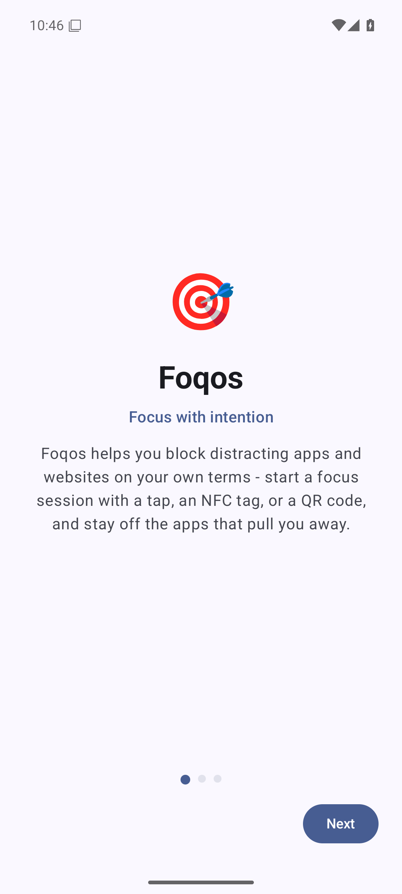
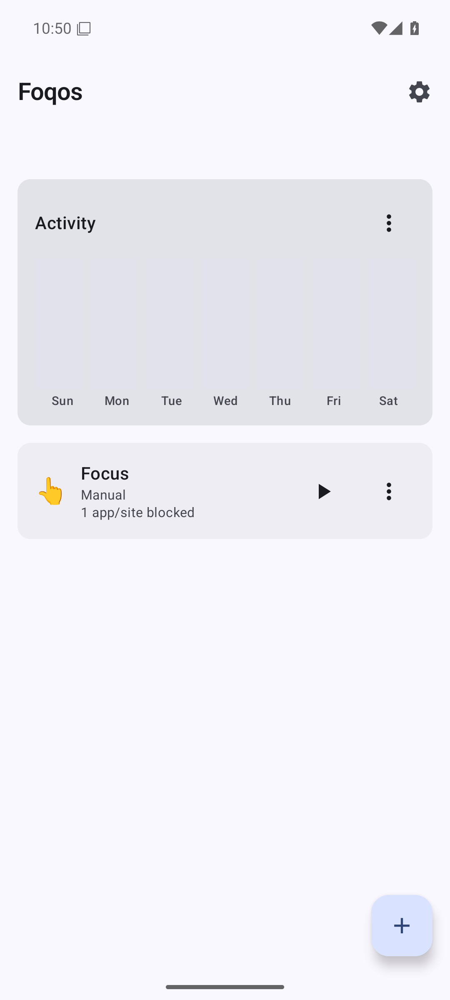
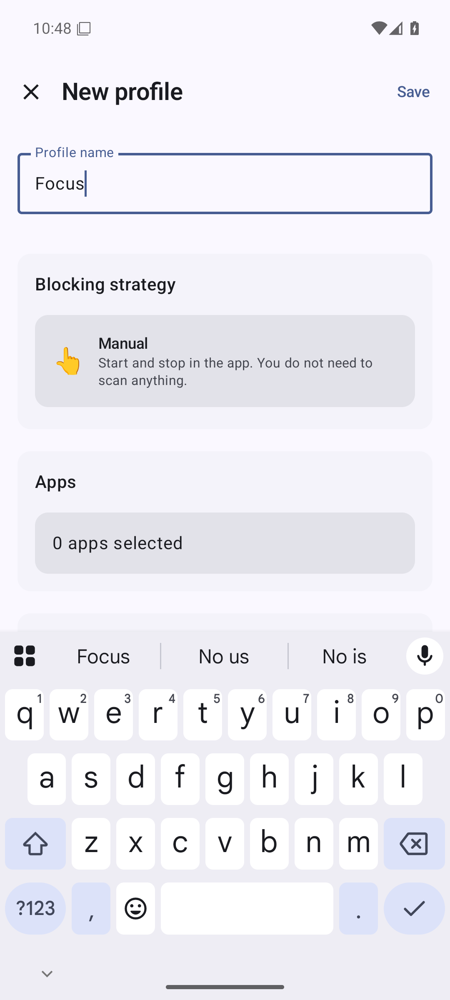
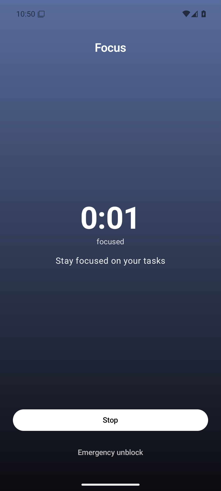
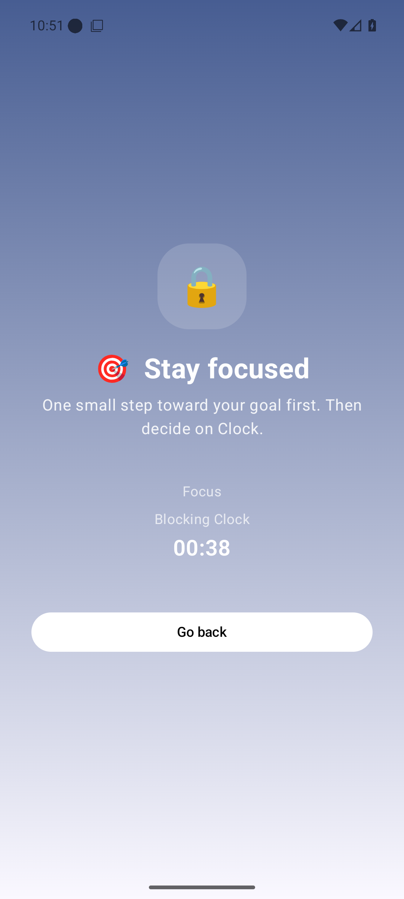
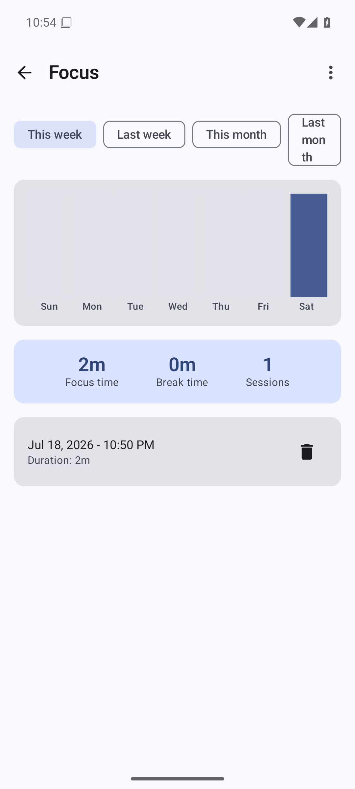

# Foqos for Android

A full-featured Android port of [Foqos](https://github.com/awaseem/foqos) — the open-source
focus app for iOS by [Ali Waseem](https://github.com/awaseem), MIT-licensed. This project
reimplements the same core idea natively for Android: block distracting apps and websites until
you deliberately end the session — by tapping in the app, scanning an NFC tag, or scanning a QR
code — rather than relying on willpower alone.

It is not affiliated with the original iOS app or its author; it is an independent, from-scratch
Android implementation of the same product concept, built against the public description and
behavior of the iOS app.

A signed APK is published in
[GitHub Releases](https://github.com/Elias02345/Foqos-Android/releases) for every version.

## Features

- **Blocking profiles** — one or more named profiles, each with its own app list (block-list or
  allow-list mode) and its own website domain list.
- **12 blocking strategies** — Manual, NFC, NFC + Manual, NFC Timer, NFC Pause Timer, NFC
  Temporary Access (soft unblock), the same five QR-code equivalents, and Timer + Manual.
- **Physical unlocks** — register specific named NFC tags or QR codes as the only valid codes
  that can stop a profile's session, instead of accepting any tag/code.
- **Schedules** — pick days of the week and a time window; the profile starts and stops itself
  automatically.
- **Timed breaks** — pause an active session for a configurable allowance instead of ending it
  outright.
- **Strict mode** — an extra layer of friction that also blocks Android Settings and the
  package installer/uninstaller while a session is active (see the honesty note below).
- **Soft unblock ("Open for N minutes")** — grant yourself a short, counted, time-boxed exception
  to open a blocked app without ending the whole session.
- **Emergency unblock** — a deliberately awkward 3-tap "break glass" escape hatch with a limited,
  resettable allowance, for when you are genuinely stuck.
- **Session history & insights** — a 4-week heatmap plus weekly and monthly charts of focused
  time.
- **CSV export** — export your full session history to a CSV file.
- **Website blocking** — block specific domains inside major Android browsers.
- **Home-screen widget** — start/stop a profile from the launcher without opening the app.
- **Quick Settings tile** — same, from the notification shade.
- **Deep links** — `foqos://profile/{id}` toggles a profile; `foqos://navigate/...` just opens
  the app (both also work as `https://foqos.app/...` links).
- **No `INTERNET` permission** — Foqos cannot phone home even if it wanted to. Everything —
  profiles, sessions, insights — stays on your device.

## Screenshots

| Onboarding | Home | Profile editor |
|---|---|---|
|  |  |  |

| Active session | Block overlay | Insights |
|---|---|---|
|  |  |  |

## Installation

1. Grab the latest `app-release.apk` from
   [GitHub Releases](https://github.com/Elias02345/Foqos-Android/releases).
2. Android will block the install by default since the APK isn't from an app store. On the
   install prompt, choose **Settings** → enable **Allow from this source** for the app you used
   to open the APK (Files, a browser, etc.), then go back and install.
3. Open Foqos and follow onboarding, which walks you through the permissions below.

## Required permissions & why

Foqos asks for more permissions than most apps because *blocking other apps* is not something
Android exposes as a simple, App-Store-friendly API — it has to be built out of several
lower-level building blocks. Every permission below is used for exactly the purpose listed, and
only when you use the corresponding feature.

| Permission | Why Foqos needs it |
|---|---|
| Accessibility service | The primary way Foqos detects which app is currently in the foreground so it can show the block screen. This is the permission that actually makes blocking work. |
| Usage access (`PACKAGE_USAGE_STATS`) | A backup way to detect the foreground app if the accessibility service is ever unavailable or gets killed. |
| Display over other apps (`SYSTEM_ALERT_WINDOW`) | Needed to draw the block screen on top of whatever app you just opened. |
| Notifications | Shows the ongoing "focus session active" status notification while a session is running. |
| Exact alarms (`SCHEDULE_EXACT_ALARM`) | Keeps timers, breaks, schedules, and soft-unblock grants firing at the precise second they're supposed to. |
| Battery optimization exemption | Optional, but recommended: without it, some Android OEMs' aggressive battery managers can kill the background service mid-session. Only requested from the explicit Settings row you tap — never silently. |
| NFC | Required only if you use one of the NFC-based strategies (scanning a tag to start/stop a session). |
| Camera | Required only if you use one of the QR-code-based strategies (scanning a code to start/stop a session). |

**No `INTERNET` permission is requested at all.** Foqos has no server, no analytics, no crash
reporting, and no network stack — it physically cannot upload your data, because it has no way to
reach the network in the first place.

## Android 13+: "Allow restricted settings"

On Android 13 and newer, apps installed from outside the Play Store are, by default, blocked from
having their accessibility service toggled on — the switch just appears greyed out in Settings.
This is a deliberate Android anti-malware protection for sideloaded apps, not a bug in Foqos. To
fix it:

1. Go to **Settings → Apps → Foqos** (or long-press the Foqos icon → **App info**).
2. Tap the **⋮** menu in the top-right corner.
3. Tap **Allow restricted settings**.
4. Go back into the accessibility settings and enable the Foqos service — it should no longer be
   greyed out.

Foqos's own permissions screen also links straight to this explanation if it detects the toggle
looks stuck.

## A note on strict mode

Strict mode makes stopping a session more annoying — it additionally blocks Android's Settings
app and the package installer/uninstaller while a session is active, so you can't casually
disable the accessibility service or uninstall Foqos to get out of a block. But it is a
**best-effort deterrent, not an OS-enforced restriction.** Unlike iOS's Screen Time API, Android
gives no app this kind of guaranteed, tamper-proof control over the rest of the system. A
sufficiently motivated user can always reach a recovery path (Safe Mode, ADB, a factory reset,
disabling the accessibility service from a quick-settings/notification shortcut before it's fully
armed, etc.). Strict mode raises the friction significantly; it does not make blocking
unbreakable. If you need a guarantee, not just a nudge, Foqos on Android is the wrong tool.

## Building from source

Requirements:

- JDK 17 or newer (JDK 21 recommended; the project has been built and tested against Temurin 21).
- Android SDK with `compileSdk`/`targetSdk` 36 installed (`ANDROID_HOME`/`local.properties`
  pointing at it).

Debug build:

```bash
./gradlew assembleDebug
```

Run unit tests / lint:

```bash
./gradlew testDebugUnitTest lintDebug
```

### Release builds & signing

Release builds are signed locally, never in CI — no keystore or password is ever stored in this
repository or in GitHub Actions secrets. Signing is **optional and additive**: if
`keystore.properties` doesn't exist, `./gradlew assembleRelease` still produces a working,
*unsigned* release APK (this is what CI does). To produce a signed release APK, create a
`keystore.properties` file in the project root (it's gitignored) with this format:

```properties
storeFile=/absolute/or/relative/path/to/your.keystore
storePassword=PLACEHOLDER_STORE_PASSWORD
keyAlias=PLACEHOLDER_KEY_ALIAS
keyPassword=PLACEHOLDER_KEY_PASSWORD
```

Then run:

```bash
./gradlew assembleRelease
```

The signed APK is written to `app/build/outputs/apk/release/app-release.apk`. Release builds run
through R8 with `isMinifyEnabled = true` and `isShrinkResources = true`; the keep rules needed for
kotlinx.serialization, ZXing, Glance, and DataStore Preferences' bundled protobuf-lite runtime
live in `app/proguard-rules.pro`.

## License

MIT — see [LICENSE](LICENSE). Based on the product concept of the original iOS app,
[Foqos](https://github.com/awaseem/foqos) by [Ali Waseem](https://github.com/awaseem), also
MIT-licensed. This is an independent Android implementation and is not affiliated with the
original project.
